## 👋 Oi, eu sou o Kauê

Desenvolvedor **full stack**, formado em **Sistemas de Informação**. Gosto de entender o problema antes de escrever código e de entregar coisa que alguém usa de verdade: o Central de Crédito foi feito **para um cliente real**.

- 🔨 Construo de ponta a ponta: banco de dados, API, regra de negócio testada e interface.
- 🔐 Levo segurança a sério: login conferido no servidor, dados protegidos por RLS, segredos fora do código e varredura automática em todo push.
- 🧪 Regra de negócio em funções puras, com teste automatizado e CI.
- 📍 Volta Redonda/RJ · disponível para **remoto, híbrido ou presencial**.

> 🇺🇸 Full stack developer (Next.js, React, TypeScript, Node.js, Python, PostgreSQL). One of my projects was built for a real client. Open to remote, hybrid or on-site roles.

## 🚀 Projetos em destaque

<table>
<tr>
<td width="50%" valign="top">

 <b>Central de Crédito</b> · <i>cliente real</i> 
Controle de vendas a prazo com nota de risco de inadimplência, fila de cobrança, previsão de caixa e lembretes automáticos no WhatsApp. <b>98 testes.</b>
</td>
<td width="50%" valign="top">

 <b>Bot Financeiro no WhatsApp</b> 
"gastei 45 no ifood" vira lançamento, categoria e saldo do mês. Núcleo sem I/O 100% testado, webhook com assinatura HMAC e custo zero.
</td>
</tr>
<tr>
<td width="50%" valign="top">

 <b>Prato na Mesa</b> · <a href="https://prato-na-mesa.vercel.app">ver demo</a> 
Cardápio em realidade aumentada: lê o QR code da mesa e o prato aparece em 3D, em tamanho real, sem instalar app.
</td>
<td width="50%" valign="top">

 <b>Detecção de Fraudes</b> · <i>TCC</i> · <a href="https://deteccao-fraudes-chi.vercel.app">ver demo</a> 
Machine learning em transações de cartão: Random Forest, XGBoost, validação cruzada e SMOTE, com o modelo rodando direto no navegador.
</td>
</tr>
<tr>
<td width="50%" valign="top">

 <b>JV Tips</b> · <i>meu primeiro projeto web</i> 
Assinatura VIP com Mercado Pago, área exclusiva, limite de 2 aparelhos por conta e verificação por e-mail.
</td>
<td width="50%" valign="top">
<h3>🔐 Segurança em todos os repositórios</h3>
<table>
<tr><th>Verificação</th><th>O que faz</th></tr>
<tr><td><b>CodeQL</b></td><td>procura falhas no código a cada push</td></tr>
<tr><td><b>Gitleaks</b></td><td>bloqueia senha ou chave vazada</td></tr>
<tr><td><b>Dependabot</b></td><td>atualiza biblioteca vulnerável</td></tr>
<tr><td><b>CI</b></td><td>roda os testes antes de entrar na <code>main</code></td></tr>
</table>
</td>
</tr>
</table>

## 🛠️ Stack

  

## 🎓 Formação

- **Bacharel em Sistemas de Informação** · Centro Universitário Geraldo Di Biase (UGB), 2025
- **Engenharia de Software** · Nano Course FIAP, 100h, 2026
- **Introduction to Cybersecurity** · Cisco Networking Academy, 2026

<picture>
  <source media="(prefers-color-scheme: dark)" srcset="https://raw.githubusercontent.com/Kauesouzavr/Kauesouzavr/output/snake-dark.svg"/>
  
</picture>

Vamos conversar? <a href="https://www.linkedin.com/in/kauesouzaproti/">LinkedIn</a> · <a href="mailto:kauesouzavr@gmail.com">kauesouzavr@gmail.com</a>

