 

Sou desenvolvedor full stack, formado em Sistemas de Informação pela UGB. Gosto de pegar um problema de verdade e entregar o sistema funcionando, do banco de dados até a tela.

Meu projeto principal é o **Central de Crédito**, feito sob medida para uma loja que vende a prazo, com nota de risco e cobrança automática pelo WhatsApp. Em todos os meus repositórios, o CodeQL e o Gitleaks rodam a cada push e o Dependabot cuida das dependências.

 

**Central de Crédito** 
Sistema de vendas a prazo feito sob medida para uma loja real. Dá uma nota de risco de inadimplência para cada comprador, monta a fila de cobrança do dia, prevê o caixa das próximas semanas e manda os lembretes pelo WhatsApp sozinho. Tem 98 testes automatizados. 
<a href="https://github.com/Kauesouzavr/Central-credito">Ver código</a>

 

**Bot Financeiro no WhatsApp** 
Você manda "gastei 45 no ifood" e o bot registra, separa por categoria e responde com o saldo do mês. A regra de negócio não depende do WhatsApp e é toda testada, e o webhook confere a assinatura de cada mensagem. 
<a href="https://github.com/Kauesouzavr/bot-financeiro-whatsapp">Ver código</a>

 

**Prato na Mesa** 
Cardápio em realidade aumentada. O cliente lê o QR code da mesa e o prato aparece em 3D, em tamanho real, em cima da mesa. Funciona no navegador, sem instalar nada. 
<a href="https://prato-na-mesa.vercel.app">Abrir a demo</a> &nbsp;&nbsp; <a href="https://github.com/Kauesouzavr/Cardapio-3D">Ver código</a>

 

**Detecção de Fraudes** 
Meu TCC levado para o código. Comparo Random Forest, XGBoost e Decision Tree em transações de cartão, e o melhor modelo roda direto no navegador, num simulador onde dá para testar uma transação. 
<a href="https://deteccao-fraudes-chi.vercel.app">Abrir a demo</a> &nbsp;&nbsp; <a href="https://github.com/Kauesouzavr/deteccao-fraudes">Ver código</a>

 

**JV Tips** 
Meu primeiro projeto web completo. Uma plataforma de assinatura com pagamento pelo Mercado Pago, área exclusiva, limite de dois aparelhos por conta e código de verificação por e-mail. 
<a href="https://github.com/Kauesouzavr/plataforma-de-aposta-tips">Ver código</a>

 

  

 

 

Estou aberto a vagas remotas, híbridas ou presenciais. O jeito mais rápido de falar comigo é pelo [LinkedIn](https://www.linkedin.com/in/kauesouzaproti/) ou pelo e-mail [kauesouzavr@gmail.com](mailto:kauesouzavr@gmail.com).

<picture>
  <source media="(prefers-color-scheme: dark)" srcset="https://raw.githubusercontent.com/Kauesouzavr/Kauesouzavr/output/snake-dark.svg"/>
  
</picture>

